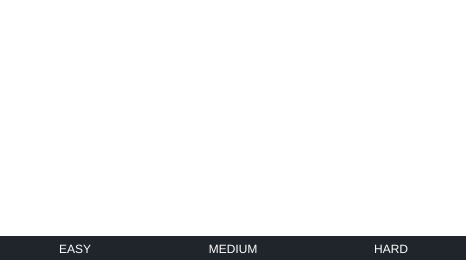

# f5Rocket

f5Rocket is a semi-8-bit vertical arcade shooter implemented as a production Q-SYS plugin. The campaign advances through Easy, Medium, and Hard stages, two minibosses, and a final boss.

## Target

- Q-SYS Designer and Q-SYS Core
- 320 × 480 logical game coordinates
- 480 × 720 plugin display
- Fixed 30 Hz gameplay simulation rate
- 20 Hz gameplay-overlay publication and 10 Hz seamless-background publication from the same timer

## Build

From the repository root:

```bash
python3 qsys/tools/build.py
```

`python3 qsys/tools/build.py game` is also accepted. Both commands validate the PNG manifest, regenerate Lua asset data, resolve the Q-SYS include graph, and write:

```text
qsys/dist/f5Rocket.qplug
```

Generated files must not be edited manually.

## Keyboard control in Q-SYS Designer Emulate (Windows)

For testing without a Core, use the standalone Windows keyboard bridge:

```text
tools/f5Rocket_Keyboard.exe
```

The helper connects to Q-SYS Designer Emulate through QRC at `127.0.0.1:1710`. It is a development/testing utility only and is not bundled into `f5Rocket.qplug`.

Before using it, set the **Code Name** of the f5Rocket plugin component in Q-SYS Designer to:

```text
f5Rocket
```

Then:

1. Open the design in Q-SYS Designer.
2. Start **Emulate** mode with F6.
3. Run `tools/f5Rocket_Keyboard.exe`.
4. Play using the laptop/PC keyboard.
5. Press F12 or close the bridge when it is no longer needed.

Keyboard mapping:

```text
W / Up Arrow       Up
S / Down Arrow     Down
A / Left Arrow     Left
D / Right Arrow    Right
Space              Fire
Enter              Run / Restart
P                  Pause toggle
F12                Exit keyboard bridge
```

The bridge uses key-down/key-up state, so simultaneous input such as `W + D + Space` works. It automatically retries the QRC connection if Designer Emulate is not running or is restarted. On exit it attempts to release `Up`, `Down`, `Left`, `Right`, and `Fire` so gameplay input is not left latched.

The native Windows source is kept at:

```text
tools/f5Rocket_Keyboard.cpp
```

The repository workflow rebuilds the standalone x64 EXE when the keyboard-bridge source changes.

## Physical USB keyboard on a Q-SYS Core

For operation on a real Core, a standard USB HID keyboard can be connected directly to a **USB-A host port** on the Core and handled by a standalone Q-SYS Control Script:

```text
qsys/control-scripts/f5Rocket_USB_Keyboard.lua
```

This path does not use the Windows QRC bridge. The proven Control Script uses direct Lua `UsbMonitor` / `Usb.New()` HID input and writes to the f5Rocket component controls.

Setup:

1. Remove the Q-SYS **USB Input** component from the design.
2. Set the f5Rocket plugin component **Code Name** to `f5Rocket`.
3. Set f5Rocket **Script Access** to `All`.
4. Add a Q-SYS **Control Script** component to the schematic.
5. Paste/use `qsys/control-scripts/f5Rocket_USB_Keyboard.lua` in that Control Script.
6. Run the design on the physical Core.
7. Connect the keyboard to a Core USB-A host port.

Core keyboard mapping:

```text
W / Up Arrow       Up
S / Down Arrow     Down
A / Left Arrow     Left
D / Right Arrow    Right
Space              Fire
Enter / KP Enter   Run
Esc                Stop
P                  Pause toggle
```

The tested script intentionally uses raw numeric Linux/Q-SYS key codes rather than `Usb.Key.*` enum names. It tracks each USB event endpoint separately and maintains global key counts, so a keyboard exposing multiple event nodes still supports true simultaneous combinations such as `W + D + Space` without duplicate Enter or Pause actions.

Command keys run only on the global up-to-down transition, repeat/held events do not retrigger them, and unplugging the keyboard releases held movement and Fire state.

For this project, the Q-SYS `USB Input` component must not be used alongside this direct Lua HID controller. Remove it and use the standalone Control Script path.

Q-SYS does not guarantee compatibility with every USB HID peripheral, so use a conventional wired USB keyboard for the most predictable behavior.

## Controls

- `Run`: momentary start/restart pulse
- `Pause`: pause/resume toggle
- `Up`, `Down`, `Left`, `Right`: cardinal movement
- `Fire`: held fire using the shared burst limiter
- `UL`, `UR`, `DL`, `DR`: touch-friendly diagonal movement
- `AutoFire`: continuous fire using the same burst limiter as manual Fire

Q-SYS input pins are exposed for `Run`, `Pause`, `Up`, `Down`, `Left`, `Right`, and `Fire`. Physical inputs can be combined in the same tick. Cardinal chord assist preserves diagonal intent for touch interfaces.

Player fire supports up to five rapid shots per burst. A complete burst triggers a one-second recovery cooldown. If no successful shot occurs for 0.5 seconds, a partial burst resets automatically. Manual Fire and AutoFire share this limiter.

## Gameplay

- Easy wave: 5,000 stage points, then Mini Boss 1
- Medium wave: 10,000 stage points, then Mini Boss 2
- Hard wave: 15,000 stage points, then the Final Boss
- Regular enemies award 100, 200, or 300 points by stage
- Bosses award 2,500, 5,000, and 15,000 points
- Player death leads to Game Over; defeating the Final Boss leads to Mission Complete


### Gameplay preview

Easy, Medium, and Hard stages:



## Rendering architecture

The plugin uses two aligned Button controls driven by one 30 Hz timer:

- `BackgroundViewport` publishes the vertically looping stage background at 10 Hz.
- `Viewport` publishes the transparent gameplay overlay at 20 Hz.

Each stage background is a seamless 320 × 480 portrait PNG. Its SVG embeds the tile once in `<defs>` and uses two integer-positioned `<use href>` instances to cover the 320 × 480 logical viewport while scrolling downward. The stages progress from the bright alien-controlled upper atmosphere, through a purple asteroid field, into the enemy headquarters. Gameplay frames use the same conservative definitions/reuse strategy. Separate 64 KiB raw-SVG guards protect both rendering paths.

Simulation remains fixed at 30 Hz. Visual publication follows a deterministic Game–Game–Background cycle, producing 20 Hz gameplay and 10 Hz background updates with at most one large Legend assignment during a normal timer callback. The renderer always uses the latest state and does not queue catch-up frames. Each dynamic gameplay SVG embeds only the PNG definitions required by its current player, stage enemy or boss, and visible explosion frames; repeated objects reference those definitions through `<use>`. Identical SVG snapshots skip Base64, JSON, and Legend publication. Fixed gameplay pools remain in use, and fully frozen Game Over or Mission Complete scenes stop the timer only after their final frame has been assigned.

Lightweight Debug Output instrumentation measures timer gaps, simulation, SVG construction, Base64, JSON, Legend assignment, and total callback time. Slow-event output is threshold-based and rate-limited, with one bounded maximum summary every 300 active ticks; it adds no controls, timers, or unbounded history.

The player uses optimized 160 × 240 PNG sources, renders at 56 × 84 logical pixels, and retains a 40 × 48 collision box. Projectiles are lightweight reusable SVG definitions.

## Repository layout

```text
assets/                                  Production PNG artwork
qsys/plugins/game/                       Authoritative modular Lua source
qsys/plugins/game/generated/             Deterministic generated asset data
qsys/control-scripts/f5Rocket_USB_Keyboard.lua
                                         Core USB-A HID keyboard controller
qsys/tools/build.py                      Production plugin build tool
qsys/dist/f5Rocket.qplug                 Generated installable plugin
tools/f5Rocket_Keyboard.cpp              Windows QDS Emulate keyboard-bridge source
tools/f5Rocket_Keyboard.exe              Standalone Windows x64 keyboard bridge
.github/workflows/build-keyboard-bridge.yml
                                         Windows bridge build workflow
.vscode/tasks.json                       Default production build task
asset_map.json                           Machine-readable asset/runtime metadata
README_ASSETS.txt                        Human-readable asset inventory
```

See [qsys/README.md](qsys/README.md) for source-module and Q-SYS validation details.
